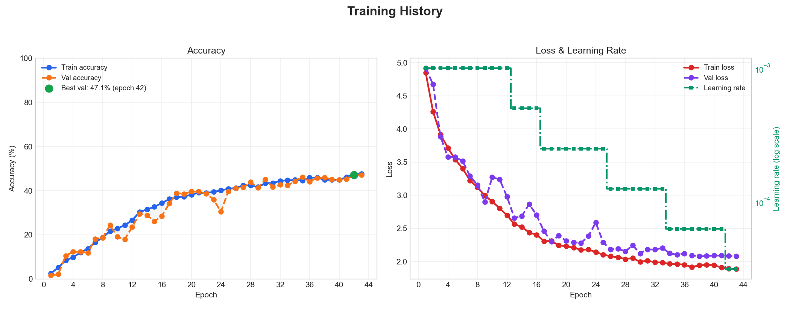
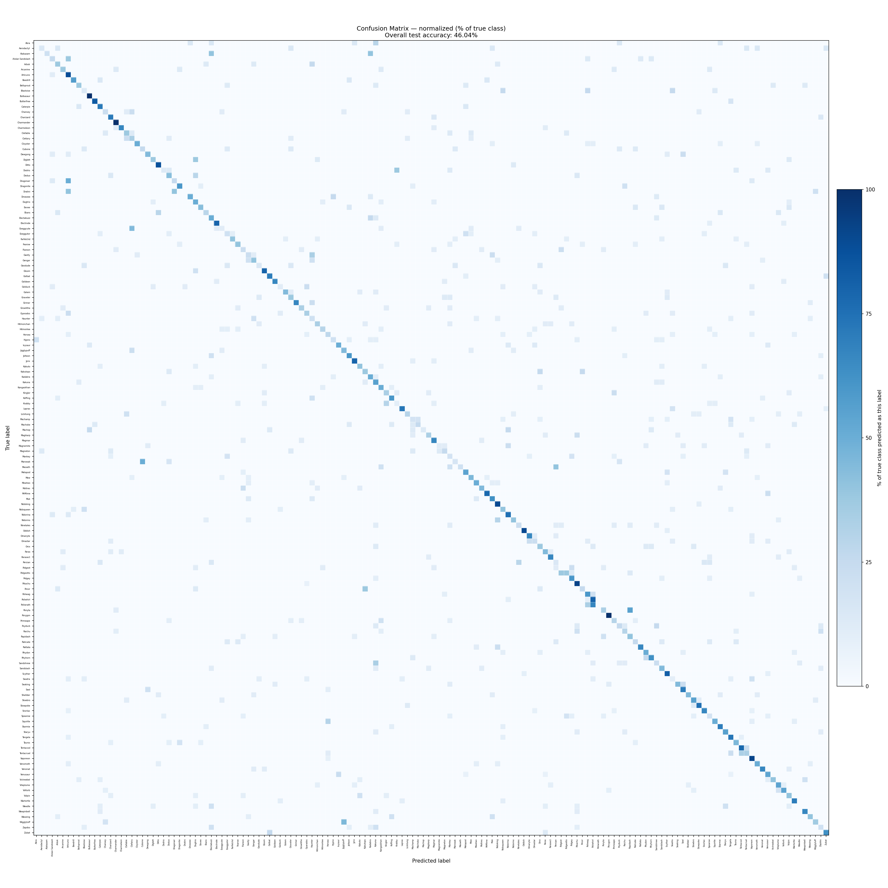

# Pokemon Image Classification — CNN

A convolutional neural network that classifies images of the first 150
Pokemon. Same pipeline shape as the earlier MLP lab (load → preprocess →
split → train → evaluate), swapped over to a small CNN built with
`tf.keras`.

## Pipeline

```
main.py
 ├─ data_loader.py     load images from PokemonData/, skip corrupted files
 ├─ preprocessing.py   BGR→RGB, resize to 100x100
 ├─ split_data.py      stratified train / val / test split
 ├─ cnn_model.py        build, train, save, predict
 └─ evaluate.py        accuracy, classification report, confusion matrix, plots
```

Run it:

```bash
cd m-project
python main.py        # full pipeline: load → train → evaluate
python test_cnn.py    # sanity-check the saved model on a few random images
```

`main.py` expects the dataset at `../PokemonData/<ClassName>/<image>.jpg`
(see the top-level README for the download link). Every intermediate
artifact — split arrays, the trained model, metrics, plots — is written to
`outputs/`.

## Data

| Split | Images |
|---|---|
| Train | 4,774 |
| Validation | 682 |
| Test | 1,364 |

150 classes, images resized to 100×100 RGB, capped at 3,000 images/class
before splitting (`MAX_PER_CLASS` in `main.py`). Split is stratified so
every class is represented in train/val/test in the same proportions.

## Model

`cnn_model.py` builds a small CNN in `tf.keras`:

- `Rescaling(1/255)` — normalization lives inside the model, so inference
  code never has to remember to do it separately.
- `RandomFlip` / `RandomRotation` / `RandomZoom` — light augmentation,
  active only during training, to keep a small CNN from memorizing the
  training set.
- 3× `[Conv2D → BatchNorm → MaxPool]` blocks (32 → 64 → 128 filters).
- `GlobalAveragePooling2D` instead of `Flatten`, to keep the dense head
  small.
- `Dense(128, relu)` with `Dropout(0.3)` on both sides of it.
- `Dense(num_classes, softmax)` output (sigmoid for the 2-class case).

Trained with Adam (`lr=1e-3`), `sparse_categorical_crossentropy`, and two
callbacks:

- `EarlyStopping(monitor="val_loss", patience=5, restore_best_weights=True)`
- `ReduceLROnPlateau(monitor="val_loss", factor=0.5, patience=3, min_lr=1e-5)`

Configured for up to 50 epochs, batch size 32 (`EPOCHS` / `BATCH_SIZE` in
`main.py`); `EarlyStopping` usually stops training well before that.

## Results

Latest run (stopped at epoch 43 via `EarlyStopping`, 150 classes):

| Metric | Value |
|---|---|
| Best validation accuracy | 47.1% (epoch 42) |
| Test accuracy | 46.04% |

150 look-alike classes is still a hard problem for a CNN this small, but
accuracy roughly doubled compared to the earlier 10-epoch run. Train and
val accuracy track each other closely throughout (see the training
history plot below), so the model isn't overfitting — it's just leveling
off. `ReduceLROnPlateau` fired several times over the run, each visible
as a step down in the learning rate curve, and `EarlyStopping` (patience
5) ended training once val loss stopped improving.



The confusion matrix is normalized per true class (each row sums to
100%), so it reads as "recall %" on the diagonal and stays comparable
even though classes don't all have the same number of test images. With
150 classes, per-cell numbers are dropped in favor of a shared 0–100%
color scale — the diagonal stands out clearly, and the pale off-diagonal
cells show which Pokemon get confused with which.



## Files in `outputs/`

| File | What it is |
|---|---|
| `cnn_model.keras` | trained model |
| `history.json` | per-epoch accuracy/loss/learning_rate |
| `classes.json` | class index → Pokemon name |
| `confusion_matrix.png`, `training_history.png`, `prediction_sample.png` | plots |
| `features.npy`, `labels.npy` | full preprocessed dataset before splitting |
| `X_train/val/test.npy`, `y_train/val/test.npy` | the split used for this run |

## Next steps

- Val accuracy has plateaued around 47% under `EarlyStopping` — the
  small CNN itself is now the bottleneck, not epoch count.
- More data per class (raise or drop `MAX_PER_CLASS`) — 150 visually
  similar classes benefit a lot from more examples each.
- Try transfer learning (e.g. `MobileNetV2` / `EfficientNet` as a frozen
  backbone) — likely the fastest way to a big accuracy jump on a dataset
  this size.
